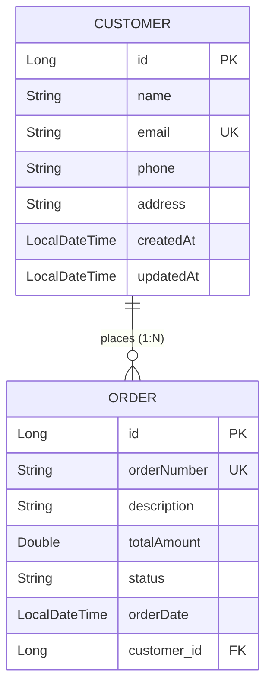

# Spring Boot REST API & Hibernate / JPA Persistence

A robust, production-grade RESTful API built with **Spring Boot 3**, **Spring Data JPA (Hibernate)**, **Jakarta Validation**, and **MySQL 8 / H2**, implementing comprehensive CRUD endpoints, custom queries, relationship mappings, and centralized error handling.

---

## Features & Implementation Highlights

- **JPA Relationship Mappings**:
  - `@Entity` and `@Table` mappings with table indexing.
  - Bidirectional `@OneToMany` and `@ManyToOne` relationship mappings between `Customer` and `Order`.
  - Cascading (`CascadeType.ALL`), orphan removal (`orphanRemoval = true`), and lazy loading (`FetchType.LAZY`).
  - Helper synchronization methods (`addOrder`, `removeOrder`) to maintain consistency.
- **Spring Data JPA Repositories**:
  - Extends `JpaRepository<T, ID>`.
  - Derived query methods (`existsByEmail`, `findByOrderNumber`).
  - Custom JPQL queries with `@Query` (e.g. multi-field keyword search, threshold filtering).
  - High-performance `JOIN FETCH` queries (`findByIdWithOrders`) eliminating the N+1 select problem.
  - Native SQL queries (`nativeQuery = true`) and aggregation queries (`SUM`, `COALESCE`).
- **RESTful API Controllers**:
  - Full CRUD operations supporting `GET`, `POST`, `PUT`, and `DELETE`.
  - Idiomatic HTTP status codes (`201 Created`, `200 OK`, `204 No Content`, `400 Bad Request`, `404 Not Found`, `409 Conflict`).
- **Request Payload Validation**:
  - Validated using Jakarta Validation: `@NotNull`, `@Size`, `@Email`, `@NotBlank`, and `@Positive`.
  - Controller methods enforce validation via `@Valid`.
  - Centralized `@RestControllerAdvice` exception handler transforming validation errors into structured, field-specific JSON responses.
- **Decoupled DTO Architecture**:
  - Clean separation between internal JPA entities and public API contracts using DTOs (`CustomerRequestDTO`, `CustomerResponseDTO`, `OrderRequestDTO`, `OrderResponseDTO`).
  - Eliminates circular JSON reference loops and lazy-loading proxy serialization issues.
- **Dual Database Configuration**:
  - Default **H2 In-Memory Database** profile for instant, zero-dependency local runs and tests.
  - Dedicated **MySQL 8.0** profile configured for production deployments and local MySQL services.

---

## Domain Model & Architecture



---

## Project Structure

```
.
├── pom.xml
├── .gitignore
├── README.md
└── src/
    ├── main/
    │   ├── java/com/example/api/
    │   │   ├── ApiApplication.java
    │   │   ├── controller/
    │   │   │   ├── CustomerController.java
    │   │   │   └── OrderController.java
    │   │   ├── dto/
    │   │   │   ├── request/
    │   │   │   │   ├── CustomerRequestDTO.java
    │   │   │   │   └── OrderRequestDTO.java
    │   │   │   └── response/
    │   │   │       ├── CustomerResponseDTO.java
    │   │   │       ├── OrderResponseDTO.java
    │   │   │       └── ErrorResponseDTO.java
    │   │   ├── entity/
    │   │   │   ├── Customer.java
    │   │   │   └── Order.java
    │   │   ├── exception/
    │   │   │   ├── DuplicateResourceException.java
    │   │   │   ├── GlobalExceptionHandler.java
    │   │   │   └── ResourceNotFoundException.java
    │   │   ├── repository/
    │   │   │   ├── CustomerRepository.java
    │   │   │   └── OrderRepository.java
    │   │   └── service/
    │   │       ├── CustomerService.java
    │   │       ├── OrderService.java
    │   │       └── impl/
    │   │           ├── CustomerServiceImpl.java
    │   │           └── OrderServiceImpl.java
    │   └── resources/
    │       ├── application.properties
    │       ├── application-h2.properties
    │       └── application-mysql.properties
    └── test/
        └── java/com/example/api/
            └── CustomerOrderApiIntegrationTest.java
```

---

## API Endpoints Reference

### Customer Endpoints (`/api/v1/customers`)

| Method | Endpoint | Description | Status Code |
|---|---|---|---|
| `POST` | `/api/v1/customers` | Create a new customer with validation | `201 Created` |
| `GET` | `/api/v1/customers` | Retrieve all customers | `200 OK` |
| `GET` | `/api/v1/customers/{id}` | Retrieve customer by ID | `200 OK` |
| `GET` | `/api/v1/customers/{id}/orders` | Retrieve customer with orders (`JOIN FETCH`) | `200 OK` |
| `GET` | `/api/v1/customers/search?keyword=...` | Search customers by name or email | `200 OK` |
| `PUT` | `/api/v1/customers/{id}` | Update customer by ID | `200 OK` |
| `DELETE` | `/api/v1/customers/{id}` | Delete customer and cascading orders | `204 No Content` |

### Order Endpoints (`/api/v1/orders`)

| Method | Endpoint | Description | Status Code |
|---|---|---|---|
| `POST` | `/api/v1/orders` | Create an order for a customer | `201 Created` |
| `GET` | `/api/v1/orders` | Retrieve all orders | `200 OK` |
| `GET` | `/api/v1/orders/{id}` | Retrieve order by ID | `200 OK` |
| `GET` | `/api/v1/orders/customer/{customerId}` | Retrieve all orders of a customer | `200 OK` |
| `GET` | `/api/v1/orders/filter?minAmount=...` | Filter orders exceeding minimum amount | `200 OK` |
| `GET` | `/api/v1/orders/status/{status}` | Filter orders by status (Native Query) | `200 OK` |
| `GET` | `/api/v1/orders/customer/{customerId}/total-spent` | Calculate total money spent by customer | `200 OK` |
| `PUT` | `/api/v1/orders/{id}` | Update order by ID | `200 OK` |
| `DELETE` | `/api/v1/orders/{id}` | Delete order by ID | `204 No Content` |

---

## Validation & Error Handling

When request payload validation fails, the API returns a structured `400 Bad Request` payload:

```json
{
  "timestamp": "2026-10-13T21:40:00",
  "status": 400,
  "error": "Validation Error",
  "message": "Request payload failed validation checks.",
  "path": "/api/v1/customers",
  "validationErrors": {
    "name": "Customer name must be between 2 and 100 characters",
    "email": "Email must be a valid email address"
  }
}
```

---

## cURL Testing Examples

### 1. Create a Customer
```bash
curl -X POST http://localhost:8080/api/v1/customers \
  -H "Content-Type: application/json" \
  -d '{
    "name": "Alice Smith",
    "email": "alice.smith@example.com",
    "phone": "+1-555-0199",
    "address": "123 Tech Boulevard, Silicon Valley"
  }'
```

### 2. Validation Error Example
```bash
curl -X POST http://localhost:8080/api/v1/customers \
  -H "Content-Type: application/json" \
  -d '{
    "name": "",
    "email": "not-an-email"
  }'
```

### 3. Create an Order
```bash
curl -X POST http://localhost:8080/api/v1/orders \
  -H "Content-Type: application/json" \
  -d '{
    "customerId": 1,
    "orderNumber": "ORD-2026-001",
    "description": "MacBook Pro M3 Max 32GB",
    "totalAmount": 2499.00,
    "status": "COMPLETED"
  }'
```

### 4. Fetch Customer with Associated Orders (`JOIN FETCH`)
```bash
curl -X GET http://localhost:8080/api/v1/customers/1/orders
```

### 5. Custom Query: Filter Orders by Minimum Amount
```bash
curl -X GET "http://localhost:8080/api/v1/orders/filter?minAmount=1000.00"
```

### 6. Custom Aggregation Query: Customer Total Spent
```bash
curl -X GET http://localhost:8080/api/v1/orders/customer/1/total-spent
```

### 7. Update Customer
```bash
curl -X PUT http://localhost:8080/api/v1/customers/1 \
  -H "Content-Type: application/json" \
  -d '{
    "name": "Alice Johnson",
    "email": "alice.johnson@example.com",
    "phone": "+1-555-9988",
    "address": "456 Innovation Way"
  }'
```

### 8. Delete Customer
```bash
curl -X DELETE http://localhost:8080/api/v1/customers/1
```

---

## How to Build and Run

### Prerequisites
- **Java 17+** (or Java 21 / 26)
- **Maven 3.8+**
- *(Optional)* **MySQL 8.0**

### Run with Default Profile (In-Memory H2 DB)
```bash
mvn spring-boot:run
```
- Access H2 Console at `http://localhost:8080/h2-console`
  - JDBC URL: `jdbc:h2:mem:customer_order_db`
  - Username: `sa`
  - Password: *(empty)*

### Run with MySQL Profile
```bash
mvn spring-boot:run -Dspring-boot.run.profiles=mysql
```
Or set environment variables:
```bash
export DB_URL="jdbc:mysql://localhost:3306/spring_jpa_db?createDatabaseIfNotExist=true"
export DB_USERNAME="root"
export DB_PASSWORD="yourpassword"
export SPRING_PROFILES_ACTIVE="mysql"
mvn spring-boot:run
```

### Execute Test Suite
```bash
mvn test
```
